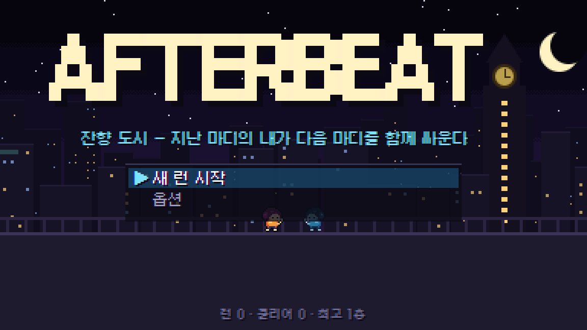
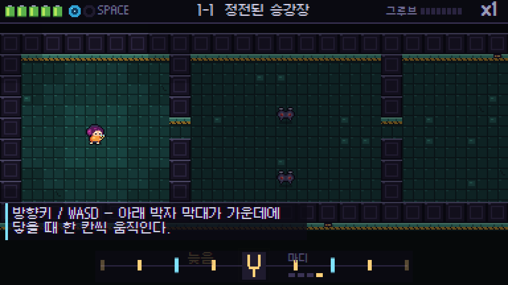
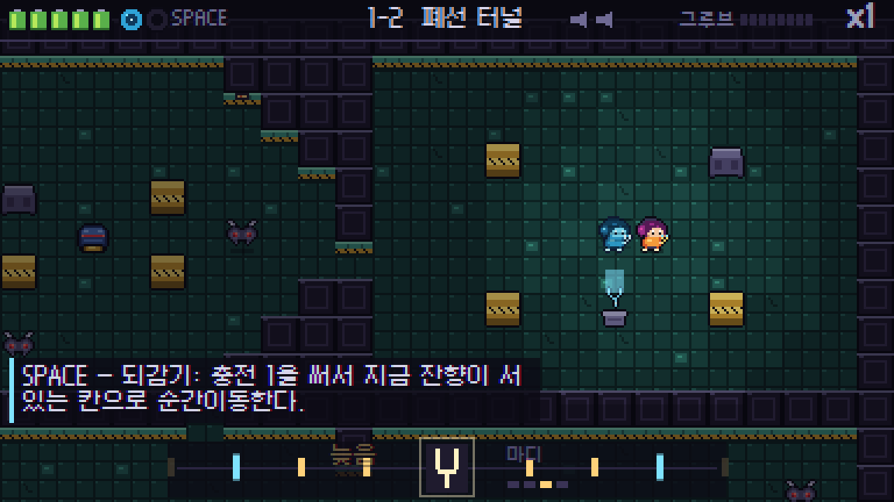
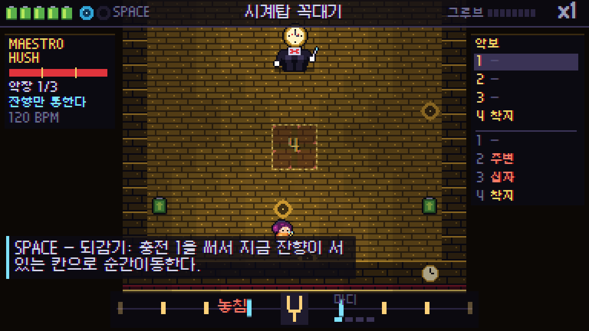

# AFTERBEAT — 잔향 도시

정전으로 멈춘 도시에서 **지난 마디(4박)의 내가 남긴 잔향**과 함께 싸우는 리듬 전술 로그라이크입니다. 박자에 맞춰 이동하고, 과거의 나와 공격을 겹쳐 도시의 소리를 되찾으세요.

**[브라우저에서 플레이](https://legerdo.github.io/echo-rhythm/)** · [GitHub 저장소](https://github.com/Legerdo/echo-rhythm)



## 게임 스크린샷

| 정전된 승강장 | 폐선 터널과 잔향 |
| --- | --- |
|  |  |



Chrome에서 프로덕션 빌드를 직접 실행해 촬영한 화면입니다. 폐선 터널과 보스전은 기존 디버그 URL로 해당 층에 진입해 촬영했습니다.

## 플레이 방법

1. [게임 페이지](https://legerdo.github.io/echo-rhythm/)를 데스크톱 브라우저로 엽니다.
2. `Enter`를 눌러 소리를 활성화하고, **새 런 시작**을 선택합니다.
3. 박자에 맞춰 한 칸씩 움직이며 적을 공격합니다. 게임은 키보드 조작을 사용합니다.

| 키 | 동작 |
| --- | --- |
| 방향키 / WASD | 박자에 맞춰 한 칸 이동. 적이 있는 칸으로 움직이면 공격 |
| Space / Shift | 되감기: 충전 1을 써서 잔향이 서 있는 칸으로 순간이동 |
| Esc / P | 일시정지 |
| Enter / Z | 메뉴 결정 |
| Backspace / X | 뒤로 |

처음에는 **정전된 승강장**에서 이동과 공격을 익힙니다. 다음 층부터 잔향과 함께 폐선 터널, 네온 시장, 옥상 변전소를 지나 보스 **MAESTRO HUSH**에 도전합니다.

## 핵심 규칙

- 한 마디는 4박입니다. 내가 한 행동은 다음 마디에 **잔향**으로 한 번 재생됩니다.
- 잔향은 지난 이동과 공격을 되풀이합니다. 아이템과 출구는 사용하지 않습니다.
- **공명**: 나와 잔향이 같은 박에 같은 대상을 치면 3 피해를 주며, 방패·장갑을 관통하고 충전이 1 증가합니다.
- 중계기를 공명으로 복구하면 음악에 악기가 돌아옵니다. 모든 중계기를 복구하면 출구가 열립니다.
- 박자 앞뒤에는 입력 판정 창이 있습니다. 조금 이른 입력은 버퍼에 보관하고, 늦은 입력은 다음 박에 실행하며 그루브가 줄어듭니다.
- 층을 클리어하면 진행이 브라우저에 저장됩니다. 같은 브라우저·사이트에서 **이어하기**를 사용할 수 있습니다.

## 로컬 실행

Node.js 24와 npm이 필요합니다.

Windows에서는 저장소를 내려받은 뒤 **`run.bat`을 더블클릭**하면 됩니다. 의존성이 없으면 설치한 뒤 개발 서버와 브라우저를 엽니다. 종료하려면 실행 창을 닫으세요.

터미널에서도 실행할 수 있습니다.

```sh
npm ci
npm run dev -- --open
```

배포용 빌드를 확인하려면 다음을 실행합니다.

```sh
npm run build
npm run preview
```

터미널에 표시된 URL로 접속하세요. 개발 서버는 기본 포트가 사용 중이면 다른 포트를 선택합니다. `preview`는 4173 포트를 사용하며, 이미 사용 중이면 종료 전에 해당 서버가 무엇인지 확인하거나 `npm run preview -- --port 4174`로 다른 포트를 지정하세요.

## 문제 해결

- **소리가 나지 않음**: 게임 페이지에서 `Enter`를 누르고 브라우저·시스템 음량을 확인하세요. 옵션에서 볼륨과 입력 보정을 조절할 수 있습니다.
- **다른 탭을 보고 돌아오니 멈춤**: 탭을 벗어나면 자동 일시정지합니다. `Enter`로 재개하면 카운트인 후 진행합니다.
- **이어하기가 보이지 않음**: 층 클리어 후 저장됩니다. 다른 브라우저·로컬 서버는 저장 공간을 공유하지 않으며, 사이트 데이터를 삭제하면 저장도 지워집니다.
- **로컬 파일을 직접 열면 실행되지 않음**: `index.html` 대신 `run.bat`이나 위 서버 명령을 사용하세요.

## 구조와 개발

Vite + TypeScript + Canvas 2D + Web Audio로 구성됩니다. 내부 해상도는 384×216이며, 픽셀을 정수 배율로 확대합니다. 음악과 효과음은 코드로 합성합니다.

| 경로 | 역할 |
| --- | --- |
| `src/sim/` | 결정적 시뮬레이션, 적·보스, 절차적 생성, 검증, 자동 플레이 봇 |
| `src/audio/` | 오디오 박자 시계, 시퀀서, 합성 악기와 효과음 |
| `src/game/` | 입력 판정, 화면 흐름, 저장, 엔딩 |
| `src/render/` | 픽셀 렌더링, HUD와 이펙트 |
| `src/assets/` | 빌드에 사용하는 스프라이트 아틀라스 PNG/JSON |
| `art/afterbeat.px.js` | 스프라이트 원본(pxl DSL) |

```sh
npm test          # 시뮬레이션, 생성, 입력 판정, 저장, 봇 테스트
npm run typecheck # TypeScript 검사
npm run e2e       # 설치된 Chrome으로 브라우저 E2E 실행
```

`npm run e2e`에는 전체 런 테스트가 포함되어 시간이 걸립니다. `npm run art`로 아틀라스를 재생성하려면 별도 pxl 도구가 필요하며 `PXL` 환경 변수에 `bin/pxl.js` 경로를 지정합니다. 일반 빌드는 저장소에 포함된 아틀라스를 사용합니다.

개발용 URL 파라미터: `?seed=123`은 시드 고정, `?autoplay=1`은 입력 경로를 사용하는 봇, `?debug=1&floor=N`은 특정 층 진입입니다.

## GitHub Pages 배포

`main`에 푸시하면 [GitHub Actions](https://github.com/Legerdo/echo-rhythm/actions)에서 `npm ci` → `npm test` → `npm run build`를 실행하고 `dist/`를 GitHub Pages에 배포합니다. Vite의 상대 경로 설정(`base: './'`)으로 저장소 하위 URL에서도 에셋을 불러옵니다.

## 라이선스 메모

폰트 **Galmuri**: Copyright © 2019–2025 Lee Minseo, SIL Open Font License 1.1. [라이선스 원문](public/licenses/Galmuri-OFL.md)은 배포 사이트에도 포함됩니다. 음악·효과음·그래픽은 이 프로젝트의 코드로 생성합니다. 이 메모는 프로젝트 전체에 별도 오픈소스 라이선스를 부여하지 않습니다.
